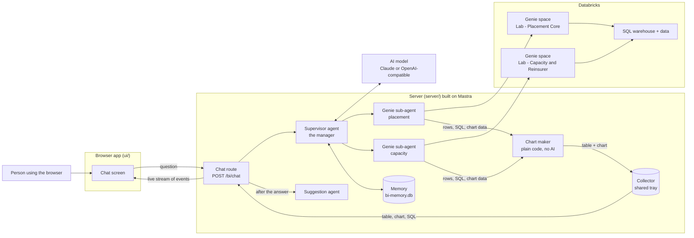
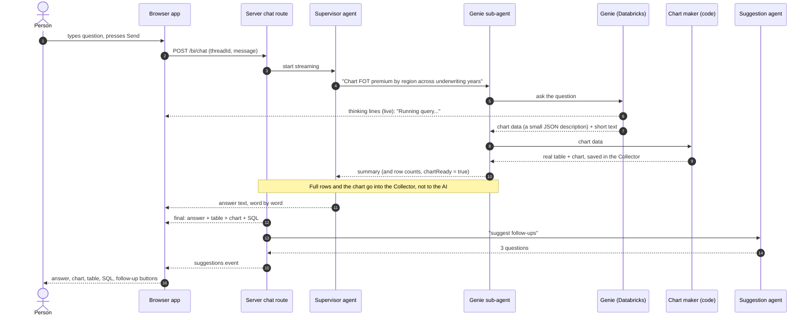

# 1. The Big Picture

> **Written before the November 2026 restructure.** File paths are updated, but some descriptions are out of date: routes, login and the chat turn are no longer in `server/src/mastra/index.ts` (now only the wiring), spaces and their ids are configuration, and settings are read once in `server/src/config`. Current layout: [onboarding/03-repo-map.md](onboarding/03-repo-map.md). Settings: `server/.env.example`.

## What the app does

A person asks a data question in normal English. The app answers with:

1. a short written answer,
2. a chart (when a chart helps),
3. a table of the data,
4. the SQL that produced the numbers,
5. a live "thinking" log while it works,
6. buttons with suggested follow-up questions.

The important rule: **the numbers come from Databricks, never from the AI's imagination.** The AI is told to only use numbers the data tool returns.

---

## The cast: who does what

Think of a small office team.

| Player | Office comparison | What it really is |
|--------|-------------------|-------------------|
| **Browser app** | The reception desk where you type | React app in `ui/` |
| **Server** | The office building | Node.js program in `server/` |
| **Supervisor agent** | The manager. Reads your question, decides who should work on it, writes the final answer | An AI (LLM) with written instructions |
| **Genie sub-agents** | Data specialists, one per data area ("placement", "capacity") | One AI agent per Genie space |
| **Chart maker** | The person who draws charts from a sketch Genie hands over | **Plain code, not an AI.** It reads the chart description Genie sends back and turns it into a chart (`mastra/chartSpec.ts`) |
| **Suggestion agent** | The person who proposes "what to ask next" | A small AI agent |
| **Genie** | A data robot at Databricks. You ask in English, it writes SQL, runs it, returns rows | A Databricks service |
| **Collector** | A shared tray on the manager's desk. Specialists drop the real data and chart here so the browser can get them | A small object in the server |

> **Why a collector?** The AI models only "see" text. But the browser needs the real table rows, the chart and the SQL. So the tools drop the full data into the collector, and the server pulls it out at the end. The AI only gets a short summary.

### Component diagram



---

## One question, start to finish

Example question: **"Chart FOT premium by region"**.



In words:

1. **You press Send.** The browser sends your message and a *thread id* (the id of this chat) to the server.
2. **The server hands it to the supervisor.** The supervisor reads its written instructions and your message.
3. **The supervisor picks a specialist.** Placement questions go to the "placement" Genie agent. Reinsurer or capacity questions go to the "capacity" agent. If a question needs both, it asks both.
4. **The specialist asks Genie.** Genie writes SQL, runs it in Databricks, and returns rows. While this happens, Genie's progress is sent live to your screen as a "thinking" log.
5. **The real data goes into the Collector.** The AI only receives a short summary and 20 sample rows, which keeps it fast and cheap.
6. **Charts come from Genie, and code draws them.** When a chart is wanted, the supervisor asks Genie for the data *as a chart* (the question contains the word "chart"). Genie sends back a small description: chart type, title, which column is x, which is y, and the data points. Plain code turns that into the table and chart. No AI is involved in drawing, and no separate chart agent exists.
7. **The supervisor writes the final answer** in short plain text. Words stream to your screen as they are written.
8. **The server sends the "final" package:** answer, table rows, chart, SQL sources.
9. **A last step writes suggestions.** A small agent proposes up to 3 follow-up questions. These arrive a moment later.

---

## Two ways to talk to Genie

The server can talk to Genie in two ways. The setting `GENIE_MODE` chooses.

| | Chat mode (older) | Agent mode (newer, currently ON) |
|---|---|---|
| Setting | `GENIE_MODE` empty | `GENIE_MODE=agent` |
| How it works | Server asks, then checks again every few seconds ("polling") until finished | Server opens a stream and Databricks pushes events as they happen |
| What you see as "thinking" | Only status words like "Running the query..." | The agent's real reasoning sentences, each SQL step, and the result |
| Row data | Full result (up to 200 rows kept) | A preview, plus a way to load all rows later |
| Suggested questions | Genie can send some | Genie sends none, so our own suggestion agent writes them |
| Status at Databricks | No separate GA entry found in the release notes we read | **GA**: the Agent mode APIs have been generally available since 27 Aug 2026. Confirm it is enabled in your workspace. Only the Flash option is Beta |
| Code file | `server/src/core/genie/client.ts` | `server/src/core/genie/agentClient.ts` |

Both give the rest of the app exactly the same kind of result, so nothing else cares which one is used.

---

## Words you will see

| Word | Plain meaning |
|------|---------------|
| **LLM** | The AI model that reads and writes text (Claude, for example) |
| **Agent** | An LLM plus written instructions plus a set of tools it may use |
| **Tool** | A function an agent can call, such as "ask Genie" or "build chart" |
| **Supervisor** | The agent that does not do the work itself but delegates to other agents |
| **Sub-agent** | An agent the supervisor can hand work to |
| **Mastra** | The code library used to build the agents, their memory, and the web server |
| **Genie** | Databricks' "ask your data in English" feature |
| **Genie space / Genie agent** | One Genie set up for one data area. Each has a long ID |
| **SQL warehouse** | The Databricks machine that actually runs SQL |
| **Unity Catalog** | Databricks' data permissions system |
| **Thread** | One chat conversation. New chat = new thread |
| **SSE (Server-Sent Events)** | A way for the server to keep one web connection open and push small messages down it |
| **Streaming** | Sending the answer in small pieces as it is produced, instead of all at the end |
| **Chart spec** | A library-neutral description of a chart (type, axes, data). The browser draws it with Recharts, Plotly or D3, chosen in `ui/src/charts/index.ts` |
| **Token** | A temporary pass that proves who you are to Databricks |
| **PAT** | Personal access token: a long-lived pass tied to one person. Used for development |
| **OAuth / PKCE** | The safe "log in with Databricks" flow. The user logs in once and the app receives a temporary token |
| **Preview rows** | Only the first rows of a bigger result |

---

## Where things live on disk

```
conversational-bi/
├── run.mjs                 Helper: setup, build, start
├── package.json            Shortcuts: npm run setup / build / start
├── README.md               Setup notes (partly out of date, see file 5)
├── docs/                   These documents
├── server/                 THE SERVER (supervisor agent lives here)
│   ├── .env                Secrets and settings. NEVER share
│   ├── .env.example        Empty template for .env. Safe to share
│   ├── package.json        Server libraries and commands
│   ├── tsconfig.json       TypeScript settings
│   ├── scripts/
│   │   └── smoke-genie.ts  Quick test: talk to Genie without the AI
│   └── src/
│       ├── contracts.ts    Shared data shapes
│       ├── auth/           Login and tokens
│       ├── genie/          Talking to Databricks Genie
│       └── mastra/         The supervisor, agents, tools, routes
└── ui/                     THE BROWSER APP
    ├── index.html
    ├── vite.config.ts
    └── src/                Screens, API calls, styles
```

Folders created automatically (do not edit): `server/.mastra/` (built server), `ui/dist/` (built browser app), `server/node_modules/` and `ui/node_modules/` (libraries), `*.db` files (chat memory).

Next: [02-server-files.md](02-server-files.md)
