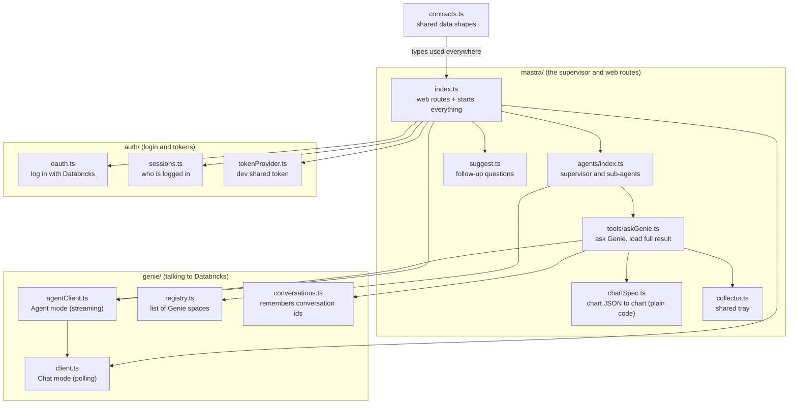
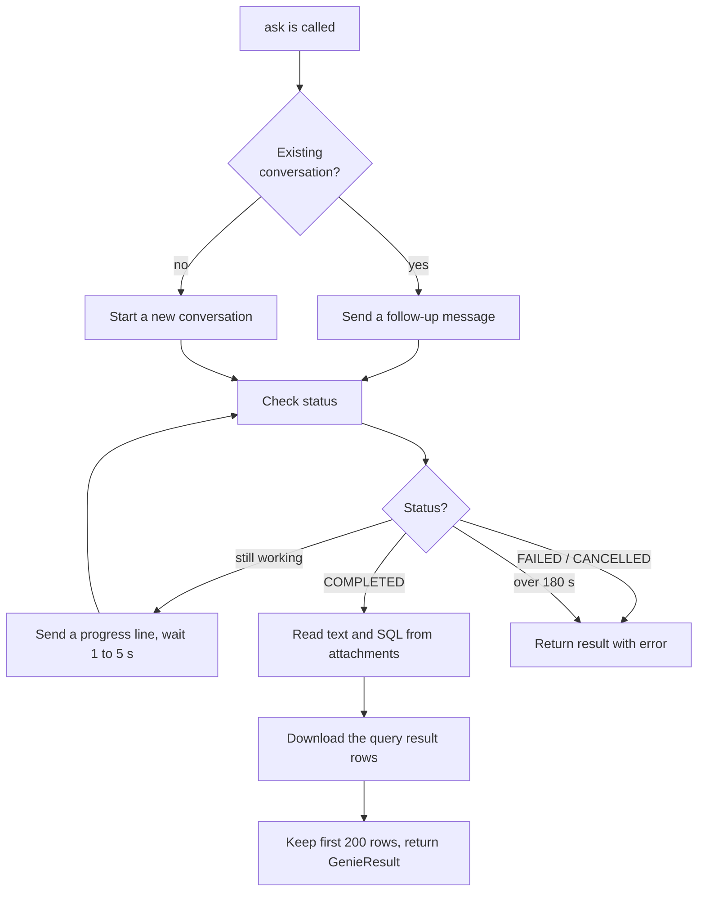
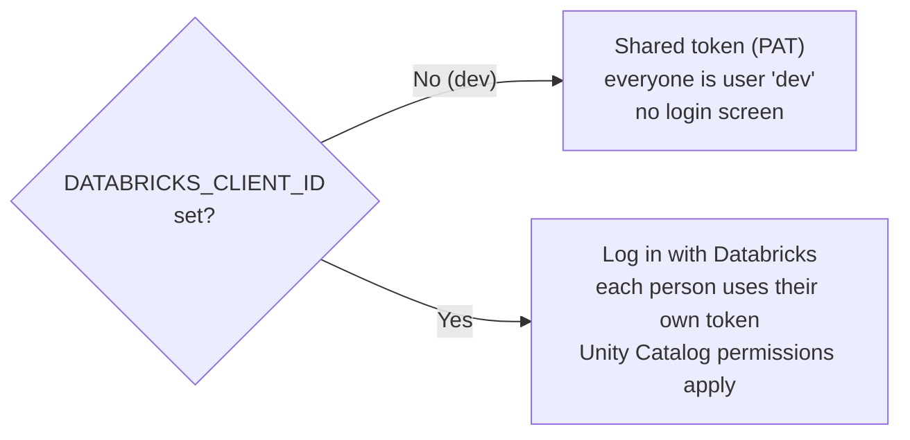
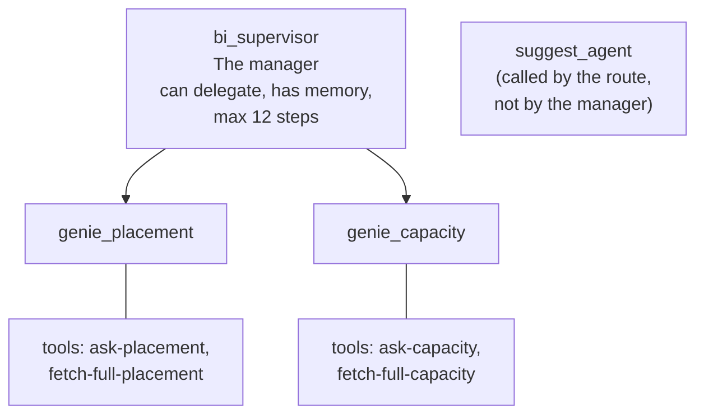
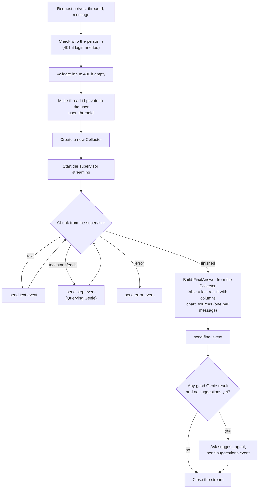

# 2. Server Files, One by One

> **Written before the November 2026 restructure.** File paths are updated, but some descriptions are out of date: routes, login and the chat turn are no longer in `server/src/mastra/index.ts` (now only the wiring), spaces and their ids are configuration, and settings are read once in `server/src/config`. Current layout: [onboarding/03-repo-map.md](onboarding/03-repo-map.md). Settings: `server/.env.example`.

All server code is in `server/src/`. Each file below has the same layout:

* **What it is**: one line.
* **What it does**: in simple words.
* **Goes in / Comes out**: its inputs and outputs.
* **Talks to**: other files it works with.
* **Good to know**: surprises and gotchas.

## The map



---

# `contracts.ts`

**What it is:** The shared dictionary of data shapes. Every other file agrees on these shapes.

**What it does:** Defines the "forms" that pass between parts of the app. It contains no logic. Think of it as the blank forms everybody fills in the same way.

| Shape | Plain meaning |
|-------|---------------|
| `GenieResult` | What one Genie call returned: text summary, SQL, columns, rows, counts, thinking lines, ids, and any error |
| `FinalAnswer` | The final package for the browser: answer text, table, chart, sources, suggested questions |
| `ChatEvent` | One small message streamed to the browser. Types: `step`, `thinking`, `text`, `final`, `suggestions`, `error` |
| `ChatRequest` | What the browser sends to start a chat: `threadId`, `message` |
| `FeedbackRequest` | What the browser sends for the thumbs up/down |
| `GenieClient` | The "promise" any Genie connector must keep: `ask`, `feedback`, and optionally `fetchFullResult` |
| `TokenProvider` | The "promise" for anything that can hand out a Databricks token |
| `GenieSpace` | One entry in the Genie list: key, name, description, space id |

**Good to know:** The browser has its own copy of these shapes in `ui/src/types.ts`. **The two copies must be kept the same by hand.**

---

# Folder `genie/`: talking to Databricks

## `genie/registry.ts`

**What it is:** The list of Genie spaces the app can use.

**What it does:** Holds two entries today:

| Key | Name | What it covers |
|-----|------|----------------|
| `placement` | Lab – Placement Core | Placement counts, layers, total limit, FOT premium by year, region, client, branch, line of business, status |
| `capacity` | Lab – Capacity & Reinsurer | Reinsurer capacity, authorized vs signed limit, unused capacity, declines to quote, quoted premium |

Each entry has a `description`. **The supervisor reads these descriptions to decide who gets a question**, so they must be specific.

**Goes in:** Environment variables `BI_SPACE_ID_PLACEMENT` and `BI_SPACE_ID_CAPACITY`. If missing, built-in default ids are used.
**Comes out:** The array `genieSpaces`, plus helpers `getSpaceByKey(key)` and `getSpaceById(id)`.
**Talks to:** `agents/index.ts` builds one sub-agent for each entry. `mastra/index.ts` uses it to show the space name next to the SQL.

**Good to know:** To add a new data area, add one more entry here. Its sub-agent and tools are created automatically.

---

## `genie/client.ts` (Chat mode, the older way)

**What it is:** The connector that talks to Genie's classic "conversation" API.

**What it does, step by step:**



* Waits between checks: 1 s, 1.5 s, 2 s, 3 s, then 5 s each time (the wait grows).
* Turns status codes into friendly lines: `FETCHING_METADATA` → "Fetching metadata…", `ASKING_AI` → "Working out the answer…", `EXECUTING_QUERY` → "Running the query…", and so on.
* Reads Genie's "thoughts" and suggested questions if the response happens to contain them.
* `feedback()` sends the thumbs up or down for a message.

**Goes in:** `spaceId`, `question`, optional `conversationId` (to continue a chat), optional `sessionId` (whose token to use), optional `onProgress` (a function that receives each progress line).
**Comes out:** A `GenieResult`. It never throws; problems are returned in its `error` field.
**Talks to:** Databricks `/api/2.0/genie/spaces/...`. Gets tokens from a `TokenProvider`.

**Good to know:**
* Max rows kept: `GENIE_ROW_CAP` (default 200). Max wait: `GENIE_TIMEOUT_MS` (default 180000 ms = 3 minutes).
* Only used when `GENIE_MODE` is not `agent`. `agentClient.ts` also uses its `feedback()`.
* The "thoughts" field is an assumption. The Databricks docs do not list it for this API, so it is probably always empty.

---

## `genie/agentClient.ts` (Agent mode, the newer way, currently ON)

**What it is:** The connector for Genie's streaming **Agent mode** (GA).

**What it does:** Sends one request and keeps the connection open. Databricks pushes events down it:

| Event item | What it means | What we do with it |
|-----------|---------------|--------------------|
| `reasoning` | The agent's thinking, in a sentence | Send to the browser's live "thinking" log; also store it |
| `function_call` (`execute_sql`) | The agent decided to run a query | Send "Running query: *title*" |
| `function_call_output` | The query finished | Mark that query done (same id) and remember the **statement id** |
| `message` | The final answer, plus a part with SQL, columns and preview rows | Build the `GenieResult` |
| `response.completed` / `failed` | The end | Finish, or record the error |

How it builds the result from the final `message`:
* The part with SQL → fills `sql`, `columns`, `rows` (first 200), and `totalRows`. This table text is **not** repeated in the summary, because the browser shows the table itself.
* The other text parts → joined into `summary`. Citation links like `[1](https://…)` are stripped.

It also has **`fetchFullResult`**: given a statement id, it downloads **all** rows from the Databricks SQL Statement API, page by page, up to a cap (default 5,000).

**Goes in:** Same as `client.ts`.
**Comes out:** A `GenieResult` (same shape as chat mode).
**Talks to:** `POST /api/2.0/genie/agents/{space}/responses` and `GET /api/2.0/sql/statements/{id}`.

**Good to know:**
* The Agent mode APIs are **GA** (since 27 Aug 2026). Admins can still switch some Genie features off, so confirm it is enabled in your workspace. Only the Flash option is Beta, so do not turn Flash on.
* Agent mode sends **no suggested questions**. That is why `suggest.ts` exists.
* Row data arrives only as a **preview**. `totalRows` says how many there really are.
* Timeout: 3 minutes (`GENIE_TIMEOUT_MS`).

**Chart answers need special handling here.** Asked for a chart, Genie runs its `chart_json` query, but in Agent mode the result looks different from a normal answer:
* The final message has **no result section** (no SQL, columns or rows). The chart JSON appears only inside the query's output, as a one-cell table.
* **The streamed output is cut off** after roughly 600 characters, in the middle of the JSON, so for anything but a tiny chart it cannot be read from the stream.
* The final text contains a Databricks display placeholder, `:embedChart{:chart[…]}`, which means nothing outside the Databricks screen.

So the client: takes the SQL from the `execute_sql` call; if the streamed JSON is complete, uses it, otherwise **loads the one-cell result by statement id** from the SQL Statement API (the complete JSON); presents it as a single `chart_json` column (the same shape chat mode gives, so one code path handles both); and removes the `:embedChart` placeholder and extra blank lines from the summary.

---

## `genie/conversations.ts`

**What it is:** A small notebook kept in the server's memory.

**What it does:** Remembers two things, per (chat thread + Genie space):
1. **The Genie conversation id**, so a follow-up like "now only 2025" continues the same Genie conversation.
2. **The last result**, so a later "yes, load everything" knows which query to reload.

**Goes in / out:** `setConversationId / getConversationId`, `setLastResult / getLastResult`.

**Good to know:** It lives only in memory. **Restart the server and it forgets.** With several server copies running, each copy has its own notebook (a problem for production; see file 5).

---

# Folder `auth/`: login and tokens

Two ways to log in, chosen by whether `DATABRICKS_CLIENT_ID` is set.



## `auth/tokenProvider.ts`

**What it is:** The dev-only token source.
**What it does:** `PatTokenProvider` returns the one shared token from `DATABRICKS_TOKEN`.
**Goes in / out:** Nothing in. A token string out (or an error if the variable is empty).
**Good to know:** The comment in the file says it can be swapped for a per-user provider "without touching callers". That is exactly the plug-in point where a service-principal provider would go for production.

## `auth/oauth.ts`

**What it is:** The "Log in with Databricks" mechanics (OAuth with PKCE).
**What it does:**
* `oauthEnabled()`: is a client id set?
* `buildLoginUrl()`: makes the Databricks login web address with a random `state` and a secret `verifier`, and remembers the verifier for 10 minutes.
* `exchangeCode(code, state)`: when Databricks sends the person back, trades the one-time code for tokens. The `state` can only be used once.
* `refreshTokens(refreshToken)`: gets a fresh access token.
* `fetchUserName(accessToken)`: reads the person's username to show in the sidebar.

**Goes in:** Settings `DATABRICKS_SERVER_HOSTNAME`, `DATABRICKS_CLIENT_ID`, optional `DATABRICKS_REDIRECT_URI`. Scopes asked: `all-apis offline_access`.
**Comes out:** `Tokens` = access token, optional refresh token, expiry time.
**Good to know:** The pending logins are kept in memory.

## `auth/sessions.ts`

**What it is:** The list of who is logged in.
**What it does:**
* `createSession` stores the person's tokens and gives back a random **session id**. The browser keeps that id in a secure cookie named `bi_sid`.
* `SessionTokenProvider.getToken` finds the session and returns the person's token. If it expires within 60 seconds, it **refreshes** it first. If several requests notice at once, only one refresh runs. If refresh fails, the session is deleted and the person must log in again.
* `FallbackTokenProvider` is the switch: OAuth on → use the session token; off → use the shared token.

**Goes in:** A session id (from the cookie).
**Comes out:** A valid token, or an `AuthError` ("Please log in again").
**Good to know:** Sessions live in memory, so a server restart logs everyone out.

## Tests: `auth/auth.test.ts`
Checks the login maths and rules: the PKCE challenge value, the login URL contents, that `state` is single use, refreshing, and cookie reading. Run with `npm test`.

---

# Folder `mastra/`: the supervisor and the web routes

## `mastra/collector.ts`

**What it is:** The shared tray (see file 1).
**What it does:** One new collector is created for **every chat request**. Tools drop things in; the route reads them out at the end.

| Slot | Holds |
|------|-------|
| `results` | Every `GenieResult` from this request (full rows, SQL, ids) |
| `chart` | The chart spec if one was built |
| `emit` | A function that sends an event straight to the browser (used for live "thinking" lines) |

Also has `getCollector(requestContext)` and `getThreadId(requestContext)` helpers. **Good to know:** because a new one is made per request, nothing carries over between questions, which is why `conversations.ts` keeps the long-term notes.

---

## `mastra/tools/askGenie.ts`

**What it is:** The two tools the Genie sub-agents use.

### Tool 1: `ask-<space>` (for example `ask-placement`)
* **Goes in:** `question` (plain text).
* **Does:**
  1. Calls the Genie client with the question, the stored conversation id, the person's session, and a callback that streams "thinking" lines to the browser.
  2. Saves the conversation id for follow-ups.
  3. If the result is chart data (one cell of JSON), converts it to a real table and a chart (see `chartSpec.ts`). In Agent mode each chart query's JSON comes separately (`chartJsons`), next to any real table. Every chart of the turn is kept, once each, so one answer can show several charts from one or more spaces.
  4. Puts the full result in the collector and remembers it as the "last result".
* **Comes out (to the AI):** a *short* package only: `summary`, `sql`, `columns`, up to 20 `sampleRows`, `totalRows`, `shownRows`, `truncated` (true if the table is only a preview), `chartReady` (true if a chart will be shown), `error`.

### Tool 2: `fetch-full-<space>`
* **Goes in:** nothing.
* **Does:** Looks up the last result for this chat and space. If it has a statement id, downloads **all** rows (cap `GENIE_FULL_ROW_CAP`, default 5,000), replaces the preview in the collector, and remembers it.
* **Comes out:** `ok`, a message ("Loaded all 1,240 rows."), `totalRows`, `shownRows`.
* **Good to know:** Only works in Agent mode. In chat mode it replies that the full result is not available.

---

## `mastra/chartSpec.ts`

**What it is:** The chart maker. Plain code, **no AI agent and no tools**. (This replaced the old `chart_agent` and `tools/chart.ts`.)

**How charts work now:** When a chart is wanted, the supervisor asks Genie for the data *as a chart*. Genie's space is set up to answer such a question with one cell of JSON text called `chart_json`, shaped like this:

```
{ "type": "column", "title": "FOT premium by year and region",
  "x": "Underwriting Year", "y": "FOT Premium USD", "series": "Region",
  "data": [ {"Underwriting Year": 2023, "Region": "APAC", "FOT Premium USD": 111081000}, ... ] }
```

| Piece | What it does |
|-------|--------------|
| `parseGenieChartJson(columns, rows)` | Checks whether a Genie result is that one-cell JSON. If so, it extracts the **real table** (the keys of the data points become the columns) and builds the chart. If it is not chart data, it returns nothing and the result is treated as an ordinary table |
| `buildChartSpec` | Turns columns and rows into a library-neutral chart spec (`ChartSpec` in `contracts.ts`). `series` becomes the colour. Number-looking text is converted to numbers. Line charts with date x values get a time axis, sorted by date |

**Goes in:** The columns and rows of a Genie result.
**Comes out:** `{ columns, rows, chart }`, where `chart` is the chart spec, or `null` if the chart type is not supported (the table is still returned), or nothing at all if the result is not chart data.
**Good to know:**
* Supported types: `column` / `bar` (drawn as bars), `line`, `scatter`. Any other type (for example `pie`) gives a table and a warning in the server console: `[chart] not drawing: type="pie"…`. If Genie's chart format has other types, they need to be added in `parseGenieChartJson`.
* The browser (not the server) finally draws the picture, with the library chosen in `ui/src/charts/index.ts`.
* It has its own tests in `chartSpec.test.ts`.

---

## `mastra/agents/index.ts`

**What it is:** Where the AI agents are created and given their instructions. **This is the heart of "the supervisor".**

### Choosing the AI model: `model()`
* If `LLM_BASE_URL` is set → use that OpenAI-compatible address (for example a company proxy), model from `LLM_MODEL`, key from `LLM_API_KEY`.
* Otherwise → Anthropic's Claude (`ANTHROPIC_MODEL`, default `claude-sonnet-5-5`) with `ANTHROPIC_API_KEY`.

### The kinds of agent



There is **no chart agent**. Charts come from Genie and are drawn by plain code (`chartSpec.ts`).

| Agent | Its job | Key instructions (summarised) |
|-------|---------|--------------------------------|
| **`bi_supervisor`** | Read the question, route it, write the final answer | Route placement/status/layer/limit/FOT questions to `genie_placement`; reinsurer/capacity/authorized/signed/declines/quoted premium to `genie_capacity`; ask one short question if unclear; never invent numbers; "year" means Underwriting Year; statuses in workflow order (Request Quote, Provide Quote, FOT, Authorization, Signed); money in USD millions with one decimal; when a chart is wanted (asked for, or clearly useful), ask Genie for the data **as a chart in the same question**, using the word "chart", and never draw one itself; only bar/column, line and scatter are drawn, so for pie or others say it is not supported and ask for the closest; if a chart was requested but `chartReady` is false, say so in one sentence; write short plain prose (no tables or bullets) because the UI already shows table, chart and SQL; never mention sub-agents or tools; if results are truncated, say it is a preview and ask whether to load the rest, and only load it if the user says yes |
| **`genie_<key>`** (one per space) | Ask Genie and report faithfully | Use only its tools; do not make up numbers; mention caveats; say so plainly on errors; report `totalRows` vs `shownRows` when truncated; use `fetch-full` only when asked to load the full result; when asked for a chart, pass the chart request to Genie and report `chartReady`, and never describe or draw a chart itself |
| **`suggest_agent`** | Propose up to 3 follow-ups | Short (under 90 characters), self-contained, answerable from the described data, never repeat the question |

**Memory:** the supervisor remembers the conversation using a small file database, `bi-memory.db`. That is how "and for last year?" works.

**Goes in:** A `GenieClient` (so agents can call Genie).
**Comes out:** `{ supervisor, genieAgents, suggestAgent }`.

**Good to know:** Changing how answers sound, how routing works, or what the supervisor refuses to do is done by editing the **instructions text** in this file. No other code change is needed.

---

## `mastra/suggest.ts`

**What it is:** A helper that asks `suggest_agent` for follow-up questions.
**Goes in:** The agent, plus the user's question, the answer and the column names.
**Comes out:** Up to 3 short question strings. If anything fails it returns an empty list (suggestions are a nice extra, never an error).

---

## `mastra/index.ts`

**What it is:** The front door and the starter. It sets everything up and defines the web addresses (routes).

### Set-up when the server starts
1. Decide the login mode (`DATABRICKS_CLIENT_ID` set or not).
2. Build the token provider.
3. Pick the Genie client: `GENIE_MODE=agent` → `agentClient.ts`; otherwise `client.ts`.
4. Build all agents.
5. Register routes, the Mastra storage database `mastra.db`, and the web server settings (port, CORS).

### The routes

| Route | Method | What it does |
|-------|--------|--------------|
| `/bi/chat` | POST | **The main one.** Runs the supervisor and streams events back |
| `/bi/feedback` | POST | Sends thumbs up/down to Genie |
| `/auth/me` | GET | Tells the browser who is logged in, or that no login is needed |
| `/auth/login` | GET | Sends the person to the Databricks login page |
| `/auth/callback` | GET | Databricks sends the person back here; creates the session, sets the cookie |
| `/auth/logout` | POST | Deletes the session and clears the cookie |
| everything else | GET | Serves the built browser app from `UI_DIST` |

### What `/bi/chat` does, in order



**Good to know:**
* Threads are private: the id is stored as `<username>::<threadId>`, so one person cannot read another's chat.
* The thinking lines do **not** come through the supervisor's stream. They are sent directly by the Genie tool via `collector.emit`.
* The table and chart shown are from the **latest** Genie result that has columns.
* **There is no heartbeat** while waiting, so a long silent step could be cut off by a strict proxy (see file 5).

---

# Other server files

| File | What it is |
|------|------------|
| `genie/client.test.ts` | Tests chat mode: polling, row cap, errors, follow-ups, using a pretend Databricks |
| `genie/agentClient.test.ts` | Tests Agent mode: streaming events arrive in tiny pieces, thinking lines, building the result, chart answers (complete and cut-off JSON), paging through large results, HTTP errors |
| `mastra/chartSpec.test.ts` | Tests the chart maker: chart JSON to table and bar chart with colours, line and scatter, unsupported types give a table only, non-chart results are ignored |
| `scripts/smoke-genie.ts` | Quick manual test: asks the first Genie space one question, then a follow-up, **without any AI**. Run: `npx tsx scripts/smoke-genie.ts "your question"` |
| `package.json` | Libraries and commands: `npm run dev`, `build`, `test`, `typecheck` |
| `tsconfig.json` | TypeScript compiler settings |
| `.env` / `.env.example` | Settings. `.env` has secrets; `.env.example` is the blank template |
| `.mastra/output/` (generated) | The built server that `npm start` actually runs. **Rebuild it after any code change** (`npm run build` in the main folder) |
| `mastra.db`, `bi-memory.db` (generated) | Mastra storage and the supervisor's chat memory |
| `../run.mjs` | Helper: `node run.mjs setup`, `build`, `start` (start sets `PORT=1976` and points `UI_DIST` at the built browser app) |

Next: [03-ui-files.md](03-ui-files.md)
