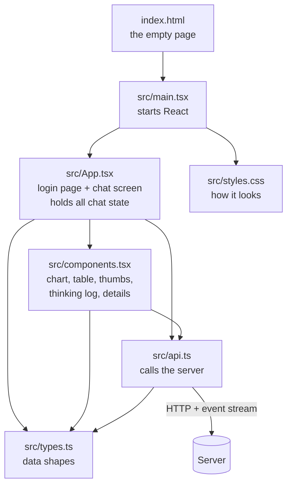
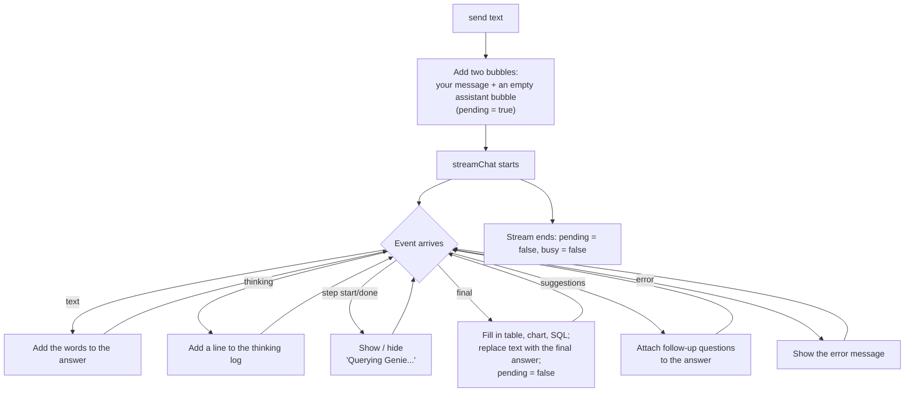

# 3. Browser App Files, One by One

> **Written before the November 2026 restructure.** File paths are updated, but some descriptions are out of date: routes, login and the chat turn are no longer in `server/src/mastra/index.ts` (now only the wiring), spaces and their ids are configuration, and settings are read once in `server/src/config`. Current layout: [onboarding/03-repo-map.md](onboarding/03-repo-map.md). Settings: `server/.env.example`.

The browser app is in `ui/`. It is a small React app. Its whole job:

1. Show a login page if needed.
2. Let the person type a question.
3. Send it to the server and **listen to the stream of events** that comes back.
4. Draw the answer, thinking log, chart, table, SQL, thumbs buttons and follow-up buttons.

It holds **no secrets** and never talks to Databricks directly. It only talks to our server.

## The map

---

## `src/types.ts`

**What it is:** The browser's copy of the data shapes from the server's `contracts.ts`.

| Shape | Meaning |
|-------|---------|
| `Source` | One Genie call: space name, the question asked, the SQL, message and conversation ids |
| `FinalAnswer` | Answer text, `columns`, `rows`, `totalRows`, `charts` (plus the deprecated `chartSpec`, the first chart), `sources`, `suggestedQuestions` |
| `ChatEvent` | One streamed message: `step`, `thinking`, `text`, `final`, `suggestions`, `error` |
| `Message` | One chat bubble. Either the user's text, or an assistant bubble with `text`, `steps` (progress), `thinking` (log lines), optional `result`, optional `error`, and `pending` (still working?) |

**Good to know:** Keep this in step with the server file by hand. If they drift apart, the screen may silently show nothing.

---

## `src/api.ts`

**What it is:** The only file that makes network calls to the server.

| Function | Calls | Does |
|----------|-------|------|
| `getMe()` | `GET /auth/me` | Asks "who am I, and is login needed?" Returns `{ authenticated, mode, user }` |
| `logout()` | `POST /auth/logout` | Ends the session |
| `streamChat(threadId, message, onEvent)` | `POST /bi/chat` | Sends the question and then **reads the event stream**, calling `onEvent` for each event. Throws `ReloginError` on a 401 |
| `sendFeedback(...)` | `POST /bi/feedback` | Sends thumbs up/down |

**How the stream is read:** the server sends text blocks separated by a blank line, each holding a line `data: {...json...}`. `streamChat` collects incoming text, cuts out each complete block, parses the JSON, and hands it to the screen immediately. That is what makes the answer and thinking appear live.

---

## `src/main.tsx`
Three lines of real work: finds the empty `
` in `index.html`, and draws `<App />` into it. Also loads the styles.

## `index.html`
The one empty page the browser loads. It has just a root `
` and a link to `main.tsx`.

## `vite.config.ts`
Settings for the developer tool (Vite). Important detail: during development it **forwards** `/bi` and `/auth` requests to the server on port 4111, so the browser sees one address and there are no cross-site problems. In normal use (`npm start`) the server itself serves the built app, so this is not needed.

---

## `src/App.tsx`

**What it is:** The main screen and the owner of all chat state. It has three parts.

### `LoginPage`
Shown when the person is not logged in. Has a "Log in with Databricks" button that goes to `/auth/login`, and shows any login error.

### `App` (the top-level part)
On load it calls `getMe()`:
* loading → "Loading…"
* not authenticated → `LoginPage`
* authenticated → `Chat`

It also reads a `?login_error=` message from the address if the login failed.

### `Chat` (the chat screen)

**What it remembers:**

| State | Meaning |
|-------|---------|
| `threadId` | The id of this chat. Saved in the browser's local storage (`bi-thread`) so a refresh keeps the same chat. "New chat" makes a new one |
| `messages` | The list of chat bubbles |
| `input` | Text typed in the box |
| `busy` | True while an answer is being produced (disables the box and buttons) |

**What happens when you send** (`send(text)`):

* A 401 (login expired) sends the person back to the login page.
* Clicking a follow-up button or a starter question simply calls `send(thatText)`.
* "New chat" clears the messages and makes a new `threadId`.

**What each assistant bubble shows, top to bottom:**
1. A progress line ("Querying Genie…") while working
2. The thinking log (open while working, collapsed after)
3. A plain "Thinking…" line if nothing else has arrived yet
4. The answer text
5. An error, if any
6. The `Details` block: chart, data table, SQL, follow-ups

**Also in `Chat`:** the dark sidebar (brand, New chat, username, Log out), three **starter questions** shown on an empty chat ("Chart FOT premium by region", "Which reinsurers left the most capacity unused?", "How many placements are there by status in 2026?"), and the input form.

---

## `src/components.tsx`

**What it is:** The reusable pieces drawn inside an answer bubble.

| Component | Input | What it draws |
|-----------|-------|---------------|
| `Chart` (from `charts/`) | A `ChartSpec` | The chart, drawn by Recharts, Plotly or D3 depending on the one line enabled in `charts/index.ts` |
| `DataTable` | `columns`, `rows` | A table. **Click a column heading to sort** (numbers sort as numbers). Numbers are right-aligned and shown with thousands separators |
| `Feedback` | One `Source` | "Helpful" / "Not helpful" buttons that call `sendFeedback`. Shows "couldn't send" if it fails |
| `Thinking` | `lines`, `live` | The thinking log as a numbered list. Open with the title "Genie is thinking…" while live; collapsed as "Genie's thinking (N steps)" afterwards. Draws nothing if there are no lines |
| `Details` | A `FinalAnswer`, `onAsk`, `disabled` | The chart (if any); a collapsible **Data** section whose title says `preview: 100 of 5,000 rows` when the table is only a preview; one collapsible **SQL** section per Genie call (with the question and the feedback buttons); and the **Suggested follow-ups** buttons |

**Good to know:**
* Clicking a suggested follow-up calls `onAsk`, which is the chat's `send`. The buttons are disabled while an answer is being produced.
* Every chart in `charts` is drawn, in order. An empty list means table only. The server builds the chart description from Genie's chart data; the browser's only job is to draw it.

---

## `src/styles.css`
How everything looks: colours, fonts and layout, following the Xoriant look (green only for main buttons; League Spartan headings, Mona Sans body text). Includes the login card, the dark 220 px sidebar, chat bubbles, the table, the thinking list, and the follow-up buttons.

## Other UI files

| File | What it is |
|------|------------|
| `package.json` | Libraries (React 19, Vite, recharts, plotly.js-basic-dist-min, d3) and commands: `npm run dev`, `npm run build` |
| `tsconfig.json` | TypeScript settings |
| `dist/` (generated) | The built app that the server serves. **Rebuild it after UI changes** |

Next: [04-data-flows-and-contracts.md](04-data-flows-and-contracts.md)
