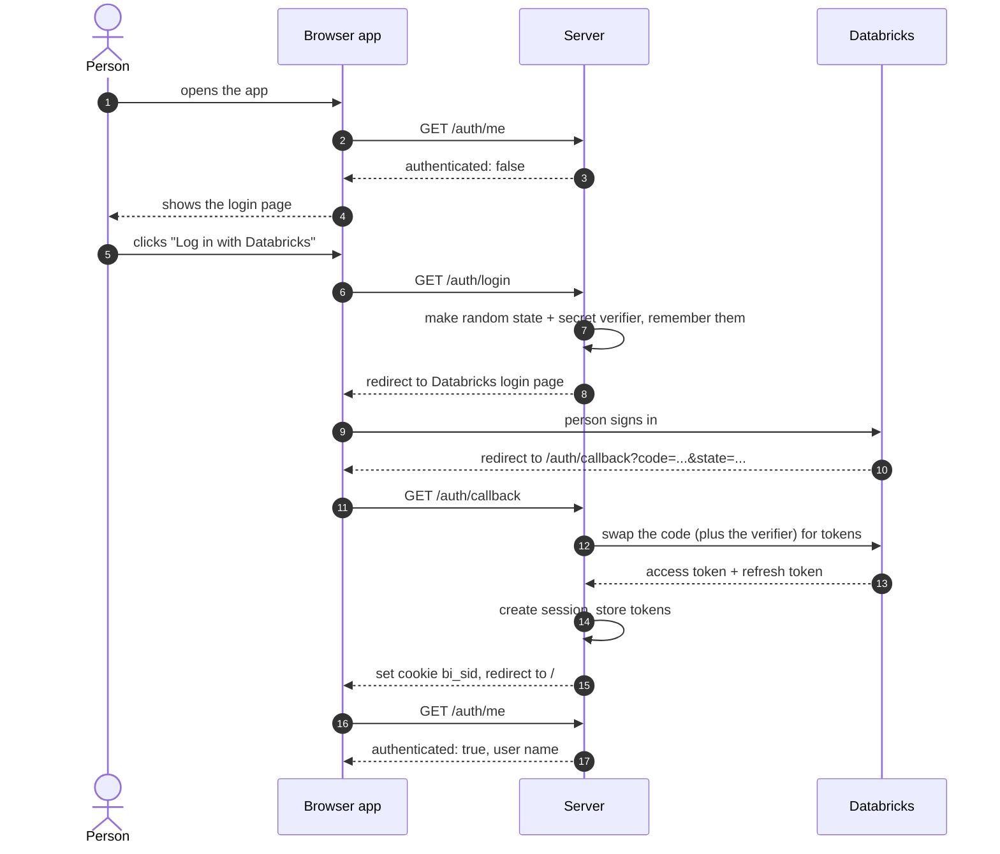
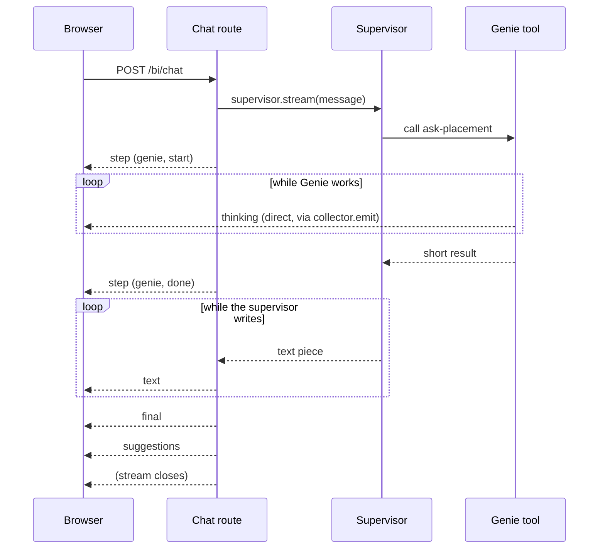
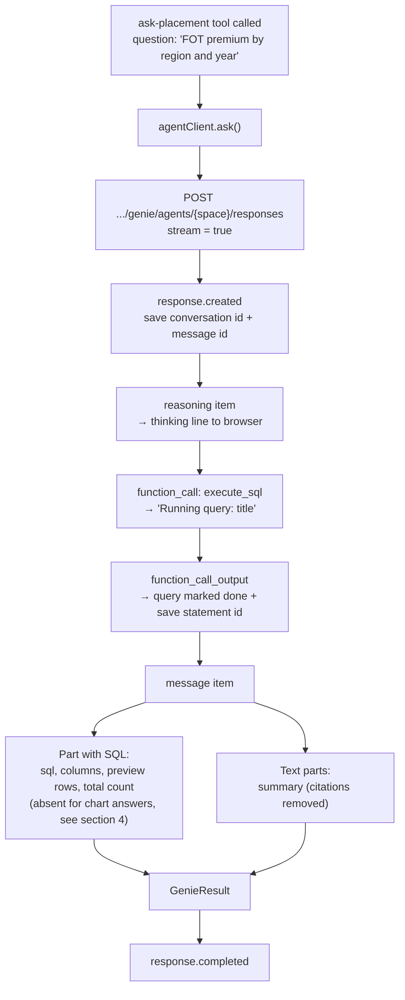
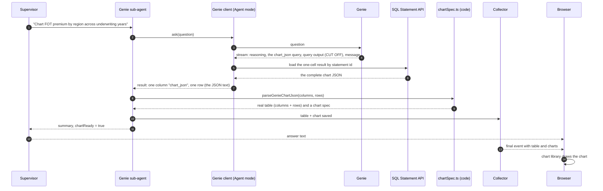
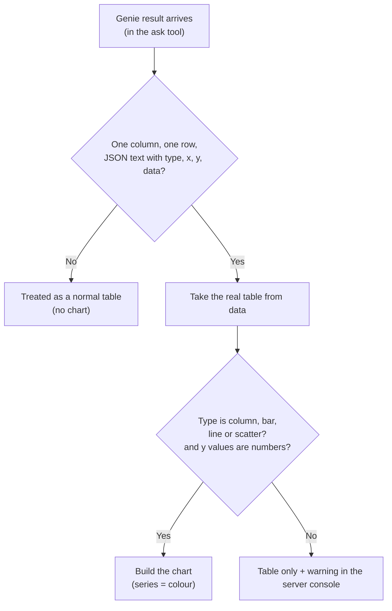
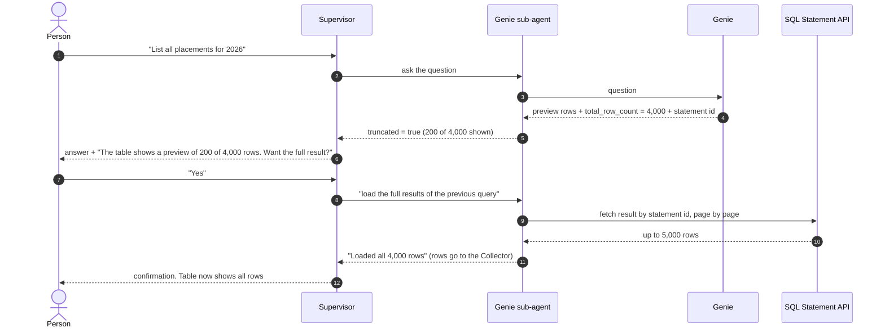
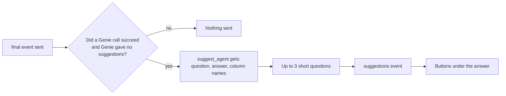

# 4. Data Flows and Contracts

> **Written before the November 2026 restructure.** File paths are updated, but some descriptions are out of date: routes, login and the chat turn are no longer in `server/src/mastra/index.ts` (now only the wiring), spaces and their ids are configuration, and settings are read once in `server/src/config`. Current layout: [onboarding/03-repo-map.md](onboarding/03-repo-map.md). Settings: `server/.env.example`.

This file shows **how data moves** through the app, and the **exact shape** of the data at each step.

Contents:
1. Login flow
2. The chat flow (what the browser sees)
3. Inside the Genie call (Agent mode)
4. How a chart gets made
5. Preview rows and "load everything"
6. Follow-up suggestions
7. The shapes of the data
8. Where each piece of data is stored

---

## 1. Login flow

### Mode A: shared token (development)
No login. Everyone is the user `dev`, and every Databricks call uses the one token in `DATABRICKS_TOKEN`.

### Mode B: Databricks login (when `DATABRICKS_CLIENT_ID` is set)



On every later request, the server reads the `bi_sid` cookie, finds the session, and uses **that person's** token for Databricks. This is why Unity Catalog permissions apply per person. About a minute before the token expires, the server refreshes it automatically.

---

## 2. The chat flow: what the browser receives

The browser sends **one** request and receives a **stream** of small events. One event per line in the form `data: {json}`, followed by a blank line.

### Events, in the typical order

| Order | Event `type` | When | Example |
|-------|--------------|------|---------|
| 1 | `step` | A sub-agent starts or ends | `{"type":"step","step":"genie","status":"start"}` |
| 2 | `thinking` | Genie reports progress (many) | `{"type":"thinking","text":"Running query: FOT Premium by Region"}` |
| 3 | `step` | Sub-agent done | `{"type":"step","step":"genie","status":"done"}` |
| 4 | `text` | The supervisor writes the answer (many small pieces) | `{"type":"text","delta":"North America leads"}` |
| 5 | `final` | Everything is finished | `{"type":"final","result":{ ...FinalAnswer... }}` |
| 6 | `suggestions` | A moment after `final` | `{"type":"suggestions","questions":["...","...","..."]}` |
| any | `error` | Something failed | `{"type":"error","message":"..."}` |



> **Two roads to the browser:** `step`, `text` and `final` go through the chat route. `thinking` goes **around** it: the Genie tool sends it straight out through the collector. That is why thinking lines appear while the supervisor is still waiting.

### Which parts of the screen each event feeds

| Event | Updates |
|-------|---------|
| `step` | The "Querying Genie…" line |
| `thinking` | The thinking log |
| `text` | The answer text, growing |
| `final` | Chart, table, SQL sections; the answer text is replaced by the final version |
| `suggestions` | The follow-up buttons |
| `error` | The red error message |

---

## 3. Inside the Genie call (Agent mode)



A real (shortened) example of what Databricks sends:

```
event: response.output_item.done
data: {"item":{"type":"reasoning","content":[{"text":"I'll get the FOT premium by region."}]}}

event: response.output_item.done
data: {"item":{"type":"function_call","name":"execute_sql","arguments":"{\"title\":\"FOT Premium by Region\",\"sql\":\"SELECT ...\"}"}}

event: response.output_item.done
data: {"item":{"type":"message","content":[
   {"text":"Here is the breakdown..."},
   {"text":"| table |","metadata":{"sql":"SELECT ...","columns":[...],"preview_rows":[[...]],"total_row_count":12}},
   {"text":"**Key highlights:** ..."}]}}
```

---

## 4. How a chart gets made

**The rule:** Genie provides the chart *information*. Plain code draws it. No AI agent makes charts.



What Genie's chart JSON contains:

| Key | Meaning | Example |
|-----|---------|---------|
| `type` | Kind of chart | `column` |
| `title` | Chart title | `FOT premium (USD) by underwriting year and region` |
| `x` | Name of the column on the horizontal axis | `Underwriting Year` |
| `y` | Name of the numeric column | `FOT Premium USD` |
| `series` | Optional: the column that splits the data into coloured groups | `Region` |
| `data` | The data points, each an object with those columns | `[{"Underwriting Year":2023,"Region":"APAC","FOT Premium USD":111081000}, …]` |

Decision rules in the code:



* **When the chart is requested:** the supervisor puts the word "chart" in the question to the Genie agent. Genie's space reacts by returning chart JSON instead of a plain table. It is done in **one** call.
* **Why Agent mode loads the JSON by statement id:** the stream cuts long query output off mid-way, so the JSON would be incomplete. See `genie/agentClient.ts` in file 2.
* **`chartReady`:** the ask tool tells the AI whether a chart will be shown. If a chart was requested but this is false, the supervisor says so in one sentence.
* **One chart per answer, tied to the latest result.** If a later Genie call returns a plain table, the earlier chart is cleared, so a chart never sits next to unrelated data.
* **Supported types:** `column`/`bar`, `line`, `scatter`. Anything else, such as `pie`, shows the table only.

---

## 5. Preview rows and "load everything"

Agent mode returns only a **preview** of large results. The app never hides this. (The numbers in the picture below are examples. The real preview size is whatever Databricks returns, and the app keeps at most 200 of those rows for display.)



Key facts:
* The supervisor is **told not to load everything on its own**. It must ask first.
* "Last result" is remembered per chat thread and Genie space in `conversations.ts`.
* Cap: `GENIE_FULL_ROW_CAP` (default 5,000). If there are more, the message says only the first 5,000 were loaded.
* Works in Agent mode only.

---

## 6. Follow-up suggestions



Skipped for small talk, clarifying questions and errors. If the suggestion step fails, the person simply sees no buttons.

---

## 7. The shapes of the data

### `GenieResult`: what one Genie call returns (server internal)

| Field | Type | Meaning |
|-------|------|---------|
| `spaceId` | text | Which Genie space answered |
| `question` | text | The question that was asked |
| `summary` | text | Genie's written answer |
| `sql` | text or null | The SQL that ran |
| `columns` | list of text | Column names |
| `rows` | list of lists | Row values (capped, see above) |
| `totalRows` | number | How many rows the full result has |
| `thinking` | list of text | Reasoning lines |
| `suggestedQuestions` | list of text | Suggestions from Genie (empty in Agent mode) |
| `statementId` | text or null | Handle for loading the full result (Agent mode) |
| `conversationId`, `messageId` | text | Genie ids, used for follow-ups and feedback |
| `error` | text or null | Problem description, or null |

### `FinalAnswer`: what the browser gets in the `final` event

| Field | Meaning |
|-------|---------|
| `answer` | The supervisor's written answer |
| `columns`, `rows` | The table: from the **last** Genie result that had columns |
| `totalRows` | Real row count. If bigger than `rows.length`, the table is a preview |
| `charts` | Every chart of the turn (`type`, `x`, `y`, `color`, `xType`, `data` each), in order; empty for table only |
| `chartSpec` | Deprecated: the first of `charts`, or `null` |
| `sources` | One entry per Genie message: space name, question, SQL, ids. Used for the SQL sections and feedback |
| `suggestedQuestions` | Usually empty here; filled later by the `suggestions` event |

### What the AI is allowed to see (kept small on purpose)

| Tool | The AI receives | The AI does **not** receive |
|------|-----------------|------------------------------|
| `ask-<space>` | summary, sql, columns, 20 sample rows, `totalRows`, `shownRows`, `truncated`, `chartReady`, error | All the rows, and the chart itself |
| `fetch-full-<space>` | ok, a message, counts | The rows |

### Per-component inputs and outputs (quick reference)

| Component | Input | Output |
|-----------|-------|--------|
| Browser `streamChat` | `threadId`, `message` | A stream of `ChatEvent` |
| Route `/bi/chat` | `{ threadId, message }` + login cookie | Event stream |
| Supervisor | The user's message, memory, request context | Streamed answer text; delegations |
| Genie sub-agent | A self-contained question | A report (text) |
| `ask-<space>` tool | `{ question }` | Short package for the AI; full result and chart into the collector |
| `parseGenieChartJson` | Columns and rows of a Genie result | Real table + chart spec, or nothing if it is not chart data |
| Genie client (either mode) | `spaceId`, `question`, `conversationId?`, `sessionId?`, `onProgress?` | `GenieResult` |
| `fetchFullResult` | `statementId`, `cap`, `sessionId?` | `{ columns, rows, totalRows }` |
| `suggestFollowUps` | agent, question, answer, columns | Up to 3 strings (or empty) |

---

## 8. Where each piece of data is stored

| Data | Stored where | Lasts how long | Problem if several server copies run? |
|------|--------------|----------------|----------------------------------------|
| Login sessions and tokens | Server memory (`sessions.ts`) | Until restart | **Yes**: person is logged out on another copy |
| Pending logins (PKCE) | Server memory (`oauth.ts`) | 10 minutes | **Yes**: the callback may hit a different copy |
| Genie conversation ids | Server memory (`conversations.ts`) | Until restart | **Yes** |
| Last result per chat | Server memory (`conversations.ts`) | Until restart | **Yes**: "load everything" could fail |
| The supervisor's chat memory | File `bi-memory.db` next to the server | Permanent | **Yes**: each copy has its own file |
| Mastra's own storage | File `mastra.db` | Permanent | **Yes** |
| Current chat id (`threadId`) | Browser local storage `bi-thread` | Until cleared | No |
| Chat bubbles on screen | Browser memory | Until refresh | No (lost on refresh) |
| The collector (this request's rows and chart) | Server memory | One request | No |

Next: [05-settings-limits-and-cookbook.md](05-settings-limits-and-cookbook.md)
