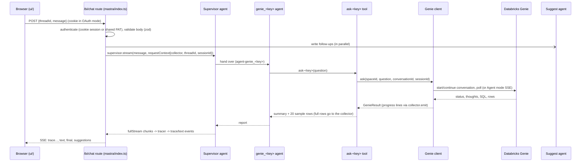

# Architecture before the restructuring

How a question travels through the server today (commit `50e54f2`).

## Every `process.env` read in `server/src`

| File | Variables |
|---|---|
| `auth/oauth.ts` | `PORT`, `DATABRICKS_SERVER_HOSTNAME`, `DATABRICKS_CLIENT_ID`, `DATABRICKS_REDIRECT_URI` |
| `auth/tokenProvider.ts` | `DATABRICKS_TOKEN` (constructor default) |
| `genie/client.ts` | `GENIE_ROW_CAP`, `GENIE_TIMEOUT_MS` (module level), `DATABRICKS_SERVER_HOSTNAME` (constructor default) |
| `genie/agentClient.ts` | `GENIE_ROW_CAP`, `GENIE_TIMEOUT_MS` (module level), `DATABRICKS_SERVER_HOSTNAME` (constructor default) |
| `genie/registry.ts` | `DATABRICKS_GENIE_SPACE_ID`, `DATABRICKS_GENIE_CAPACITY_SPACE_ID` (with built-in IDs as fallbacks) |
| `genie/retry.ts` | `GENIE_RETRY_ATTEMPTS` (module level) |
| `mastra/agents/index.ts` | `LLM_BASE_URL`, `LLM_MODEL`, `LLM_API_KEY`, `ANTHROPIC_MODEL` |
| `mastra/tools/askGenie.ts` | `GENIE_FULL_ROW_CAP` (module level) |
| `mastra/index.ts` | `GENIE_MODE`, `SUGGEST_WAIT_MS` (module level), `UI_DIST` (per request), `PORT` |

`ANTHROPIC_API_KEY` is not read by our code; the `@ai-sdk/anthropic` provider reads it.

## Module-level state

| File | State | What it holds |
|---|---|---|
| `auth/oauth.ts` | `pending` Map | PKCE verifier per login `state` (10 min TTL, swept on each login) |
| `auth/sessions.ts` | `sessions`, `refreshing` Maps | Databricks tokens per cookie session; in-flight refreshes |
| `genie/conversations.ts` | `store`, `lastResults` Maps | Genie conversation id and last result per (thread, space); no TTL, no cap |
| `mastra/history.ts` | `turns` Map | last 6 turns per thread for follow-ups; no TTL, no cap on threads |
| `genie/registry.ts` | `genieSpaces` array | the two spaces, built at import |

## Import-time side effects

- `mastra/index.ts` imports `dotenv/config`, which loads `server/.env` into `process.env`.
- `mastra/index.ts` decides OAuth or PAT mode, prints a `console.warn` in PAT mode, builds the token provider, the Genie client (which throws if `DATABRICKS_SERVER_HOSTNAME` is unset) and all agents, all at import.
- `mastra/agents/index.ts` builds a `LibSQLStore` for agent memory (`file:./bi-memory.db`) when `createAgents` runs; `mastra/index.ts` builds one for Mastra storage (`file:./mastra.db`). Both write to the working directory.
- `genie/retry.ts`, `genie/client.ts`, `genie/agentClient.ts`, `mastra/tools/askGenie.ts` read settings once at import.

## Logging today

Plain `console.warn` lines in `mastra/index.ts`, `genie/retry.ts`, `genie/agentClient.ts`, `mastra/tools/askGenie.ts` (prints up to 300 characters of a Genie result cell), `mastra/chartSpec.ts` and `mastra/suggest.ts`. No request id, no structure, no redaction.
