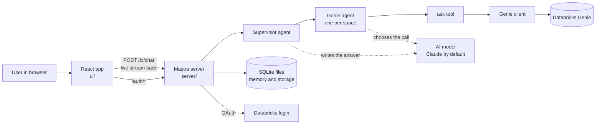

# 02. Big picture

> **Written before the November 2026 restructure.** File paths are updated, but some descriptions are out of date: routes, login and the chat turn are no longer in `server/src/mastra/index.ts` (now only the wiring), spaces and their ids are configuration, and settings are read once in `server/src/config`. Current layout: [03-repo-map.md](03-repo-map.md). Settings: `server/.env.example`.

## What you will learn
- The main parts of the system and what each one does.
- How they talk to each other.
- Why the AI is kept away from the numbers.
- What runs where in development and in production.

## The parts



Plain words for each box:

| Part | What it does | Code |
|---|---|---|
| React app | Shows the chat. Sends questions. Draws charts and tables | `ui/src/App.tsx`, `ui/src/components.tsx` |
| Mastra server | **Mastra** is a Node library for building AI agents. The server uses it to define agents and HTTP routes | `server/src/mastra/index.ts` |
| Supervisor agent | An AI "manager". It decides which specialist to ask. It writes the final short answer | `server/src/core/agents/prompts.ts` |
| Genie agent | An AI "specialist" for one Genie space. Its only job is to call the ask tool | `server/src/core/agents/prompts.ts` |
| Tool | A function an agent can call. Here: ask Genie, or load all rows | `server/src/core/agents/askGenie.ts` |
| Genie client | Plain code that calls the Databricks HTTP API | `server/src/core/genie/client.ts`, `server/src/core/genie/agentClient.ts` |
| AI model | The language model behind the agents. Claude by default. Any OpenAI-compatible endpoint if `LLM_BASE_URL` is set | `server/src/core/agents/prompts.ts`, `model()` |
| SQLite files | Small database files for agent memory and Mastra storage | `server/src/mastra/index.ts`, `server/src/core/agents/prompts.ts` |

## Why the AI is kept away from the numbers

An AI model can write numbers that look right but are wrong. So the design splits the work:

- **Genie** produces rows from real data.
- **Plain code** turns rows into tables and chart descriptions (`server/src/core/chart/chartSpec.ts`).
- **The AI** only picks the right specialist and writes a short summary.

The supervisor's rules say this directly: "Never invent numbers. Use only values returned by the sub-agents." and "Charts come from Genie, never from you." (`server/src/core/agents/prompts.ts`, supervisor `instructions`.)

Think of the AI as a receptionist. It decides which department to call and reports back. It does not do the accounting.

## The side channel

The AI model only sees text. But the browser needs rows, SQL and a chart spec. So the tool saves those into a per-request object called the **collector**. After the AI finishes, the route reads the collector and sends the data to the browser (`server/src/core/chat/collector.ts`).

```ts
// Per-request side channel: tools running inside sub-agents record structured data here
export type Collector = { results: GenieResult[]; chart: ChartSpec | null; emit?: (e: ChatEvent) => void };
```

Notice that `emit` lets a tool push live progress straight to the browser while Genie is still working.

## How the browser and server talk

- The browser sends `POST /bi/chat` with a thread id and a message.
- The server answers with **Server-Sent Events (SSE)**: a single long HTTP response that sends many small messages over time. This lets the UI show progress while the answer is being made.
- The message types are in `server/src/contracts.ts` (`ChatEvent`): `trace`, `text`, `final`, `suggestions`, `error`.
- Other routes: `POST /bi/feedback` and `/auth/me`, `/auth/login`, `/auth/callback`, `/auth/logout` (`server/src/mastra/index.ts`).

## Development versus production

| | Development | Production (`npm start`) |
|---|---|---|
| Server | `mastra dev`, port 4111 | `mastra start`, port 1976 by default |
| Browser app | Vite dev server, port 5173, proxies `/bi` and `/auth` to the server | Built files in `ui/dist`, served by the same server |
| Command | `npm run dev` in `server/` and in `ui/` | `npm run build`, then `npm start` at the root |

Sources: `server/package.json`, `ui/package.json`, `ui/vite.config.ts`, `run.mjs`.

How the app is deployed to real environments is **not in the repo**. See [11-build-test-deploy.md](11-build-test-deploy.md).

## What is in memory

Some state lives only in server memory and is lost on restart:

- Login sessions (`server/src/adapters/local/auth/sessions.ts`).
- The map from a chat thread to a Genie conversation id (`server/src/core/genie/conversations.ts`).
- The last result per thread and space (same file).

So the server is **single-copy by design today**. Two copies behind a load balancer would not share sessions.

## Key takeaways
- Browser, Mastra server, Genie: three layers. Genie owns the numbers.
- Supervisor picks a specialist. The specialist calls one tool. Plain code builds the chart.
- The collector carries rows, SQL and chart past the AI model to the browser.
- Results stream to the browser as Server-Sent Events.
- Sessions and conversation ids live in memory.

## Where to look in the code
- `server/src/mastra/index.ts`: routes and the `Mastra` object.
- `server/src/core/agents/prompts.ts`: supervisor and specialists.
- `server/src/core/agents/askGenie.ts`: the tools.
- `server/src/core/chat/collector.ts`: the side channel.
- `server/src/contracts.ts`: the shared data shapes.
