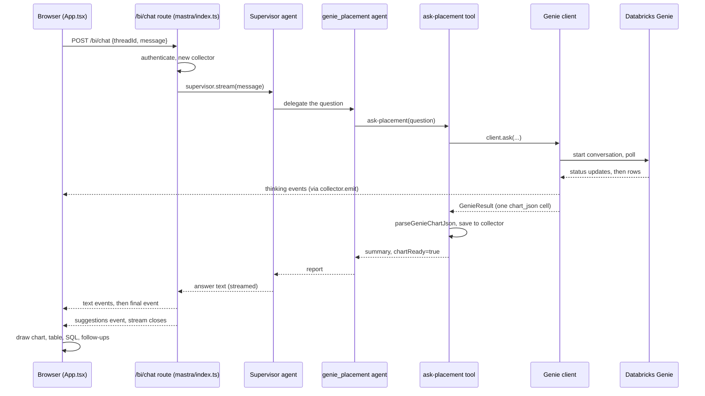

# 05. Request journey

## What you will learn
- What happens, step by step, from a button click to a chart on screen.
- Which file does each step.
- What the browser receives while it waits.
- Where each step can fail.

## The example

The user clicks the starter button **"Chart FOT premium by region"** (`ui/src/App.tsx`, `STARTERS`). We follow that one question.

## The picture



## Step by step

**1. The click.** `Chat.send` in `ui/src/App.tsx` adds the user's message and an empty assistant message to the screen. It then calls `streamChat` (`ui/src/api.ts`). The thread id comes from the browser's `localStorage` key `bi-thread`, so a page reload keeps the same chat thread.

**2. The request.** `streamChat` sends `POST /bi/chat` with `{ threadId, message }` (`ui/src/api.ts`).

**3. Who are you?** `chatRoute` in `server/src/mastra/index.ts` calls `authenticate`. In shared-token mode everyone is the user `dev`. In OAuth mode it needs a valid session cookie, or it answers 401 with `relogin: true`.

**4. Setup.** The route checks that `threadId` and `message` exist (400 if not). It prefixes the thread id with the user name, so threads are per user. It creates a `collector` and a `RequestContext` and opens the stream.

```ts
const threadId = `${who.user}::${rawThread}`; // threads are per user
const collector = newCollector();
const requestContext = new RequestContext();
requestContext.set('collector', collector);
```

Notice that the collector travels inside the request context. That is how tools reach it later.

**5. Supervisor.** The route calls `supervisor.stream(message, ...)` with memory scoped to the thread (`server/src/mastra/index.ts`). The supervisor's instructions send placement and FOT premium questions to `genie_placement`, and tell it to ask for the data "AS A CHART" when the user asks for a chart (`server/src/mastra/agents/index.ts`).

**6. Specialist and tool.** The `genie_placement` agent calls the tool `ask-placement` (`server/src/mastra/tools/askGenie.ts`, `createAskGenieTool`). The tool looks up any earlier Genie conversation for this thread and space, so follow-up questions keep context (`server/src/genie/conversations.ts`).

**7. Genie.** The tool calls `client.ask`. In the default mode (`server/src/genie/client.ts`) the client starts a conversation, then polls the message every 1 to 5 seconds until it is `COMPLETED`, fails, or 180 seconds pass. Each status change and each reasoning step goes to `onProgress`. The tool turns that into a `thinking` event with `collector.emit`. This is what the user sees as "Genie is thinking…".

**8. Chart JSON becomes a chart spec.** For a chart question, Genie returns one cell holding JSON. `parseGenieChartJson` (`server/src/mastra/chartSpec.ts`) reads it, builds the real table, and builds a `ChartSpec`. The tool stores both in the collector. It also sets `collector.chart`. The chart always belongs to the **latest** result, so a later non-chart answer clears it.

**9. The tool answers the AI.** The tool returns a short object to the agent: summary, SQL, columns, 20 sample rows, `chartReady` and so on. The AI model never sees the full table.

**10. The answer text.** The supervisor writes a short plain-text answer. The route forwards each piece as a `text` event.

**11. The final event.** When the stream ends, the route reads the collector. It builds one `FinalAnswer`: the answer, the latest table, the chart spec, one source per Genie message (SQL, question, ids), and any follow-up questions from Genie. It sends it as a `final` event.

**12. Follow-ups.** If Genie gave no suggestions and at least one result had no error, the route asks a small agent for up to three follow-up questions and sends a `suggestions` event (`server/src/mastra/suggest.ts`). Any failure there is ignored.

**13. Drawing.** `streamChat` parses each `data:` line and calls the handler in `Chat.send`. A `final` event stores the result on the message. `Details` (`ui/src/components.tsx`) draws the chart through `ui/src/charts/index.ts`, a collapsed data table, collapsed SQL with Helpful and Not helpful buttons, and the follow-up buttons.

## What the browser sees over time

| Event | When | Effect on screen |
|---|---|---|
| `thinking` | While Genie works | Lines in the "Genie is thinking…" panel |
| `step` | A Genie tool starts or ends | "Querying Genie…" status line |
| `text` | The AI writes its answer | Answer text grows |
| `final` | Work is done | Chart, table, SQL appear |
| `suggestions` | A moment later | Follow-up buttons appear |
| `error` | Anything throws | "Something went wrong: …" |

Sources: `ChatEvent` in `server/src/contracts.ts`; the handler in `ui/src/App.tsx`.

## Where it can fail

| Where | What happens |
|---|---|
| Login expired | 401 with `relogin`. The UI shows the login page again (`ui/src/api.ts`, `ReloginError`) |
| Genie error or timeout | `GenieResult.error` is set. The tool returns it. The AI should say so plainly (agent instructions) |
| Not a recognised chart | Table only. A `[chart] not drawing` warning is logged (`server/src/mastra/chartSpec.ts`) |
| Unexpected exception in the stream | An `error` event is sent and the stream closes (`server/src/mastra/index.ts`, `catch`) |
| A chart cannot be drawn in the browser | The chart is skipped, the rest of the answer stays (`ChartBoundary` in `ui/src/components.tsx`) |

## Key takeaways
- One question touches: `App.tsx`, `api.ts`, the chat route, supervisor, a Genie agent, a tool, the Genie client, `chartSpec.ts`, then `components.tsx`.
- The AI sees text only. Rows, SQL and the chart go through the collector.
- The browser gets a live stream, so it can show progress.
- The chart is built by code from Genie's chart JSON.

## Where to look in the code
- `ui/src/App.tsx`: `Chat.send`.
- `ui/src/api.ts`: `streamChat`.
- `server/src/mastra/index.ts`: `chatRoute`.
- `server/src/mastra/tools/askGenie.ts`: `createAskGenieTool`.
- `server/src/mastra/chartSpec.ts`: `parseGenieChartJson`.
- `ui/src/components.tsx`: `Details`.
