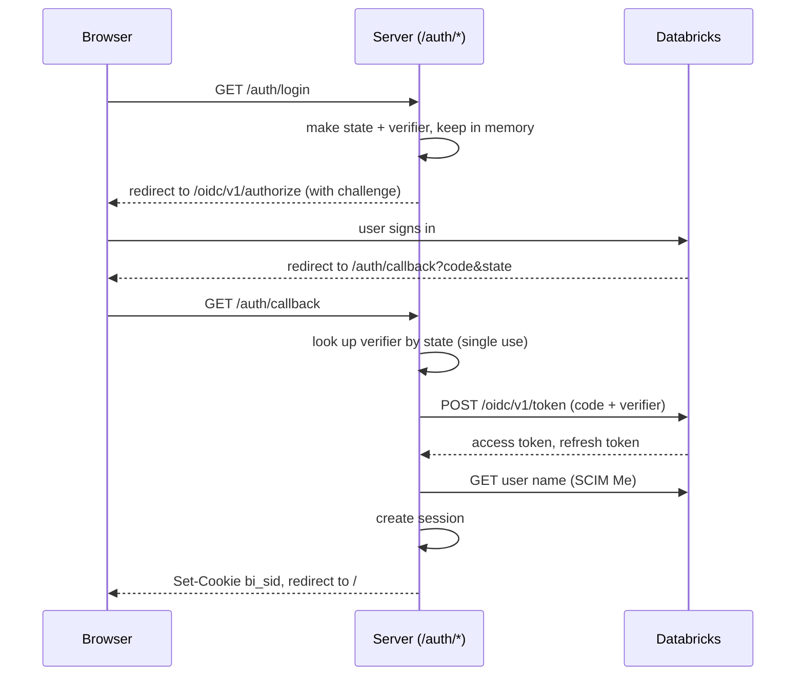

# 08. Auth and access

> **Written before the November 2026 restructure.** File paths are updated, but some descriptions are out of date: routes, login and the chat turn are no longer in `server/src/mastra/index.ts` (now only the wiring), spaces and their ids are configuration, and settings are read once in `server/src/config`. Current layout: [03-repo-map.md](03-repo-map.md). Settings: `server/.env.example`.

## What you will learn
- The two sign-in modes.
- How the OAuth sign-in works, step by step.
- How sessions and token refresh work.
- What "access control" means in this app.
- What is not covered.

## Two modes

The mode is chosen once, at start, from one setting (`server/src/mastra/index.ts`, `oauthEnabled`).

| Mode | When | Who is the user | Whose permissions Genie uses |
|---|---|---|---|
| Shared token | `DATABRICKS_CLIENT_ID` is not set | Always `dev` | The one shared token's (`DATABRICKS_TOKEN`) |
| OAuth | `DATABRICKS_CLIENT_ID` is set | The signed-in Databricks user | That user's own access token |

In shared-token mode the server logs a warning at start: "using the shared DATABRICKS_TOKEN, no user login". The README calls this "dev only".

**OAuth** is a standard way to sign in through another service without sharing your password with the app. Here the other service is Databricks.

**PKCE** (said "pixie") is an extra safety step for apps that cannot keep a secret. The app invents a random secret per login, sends only a hash of it first, and shows the real secret at the end to prove it is the same app. This app registers as a public client with no client secret (`README.md`, Login).

## The sign-in flow



Sources: `server/src/mastra/index.ts` (`authRoutes`), `server/src/adapters/local/auth/oauth.ts` (`buildLoginUrl`, `exchangeCode`, `fetchUserName`).

Details worth knowing:

- The scopes asked for are `all-apis offline_access` (`oauthConfig`). `offline_access` is what gives a refresh token.
- The random `state` and the PKCE verifier are kept in a `Map` on the server. Entries expire after 10 minutes, and each is deleted when used once (`exchangeCode`).
- The redirect address defaults to `http://localhost:<PORT>/auth/callback`. Override it with `DATABRICKS_REDIRECT_URI`. It must match what is registered in Databricks.
- If anything fails, the server redirects to `/?login_error=<message>` and the UI shows that message (`ui/src/App.tsx`).

## Sessions and the cookie

After sign-in the server creates a session and sends a cookie.

```ts
`${COOKIE}=${value}; HttpOnly; SameSite=Lax; Path=/; Max-Age=${maxAgeSec}${secure ? '; Secure' : ''}`
```

Notice `HttpOnly`: browser scripts cannot read the cookie. The cookie name is `bi_sid`. Its life is 8 hours (`/auth/callback` passes `8 * 3600`). `Secure` is added only when the request URL is `https`. All from `server/src/adapters/local/auth/sessions.ts` and `server/src/mastra/index.ts`.

A session holds the access token, the refresh token, the expiry time and the user name. It lives in a `Map` in server memory. A restart signs everyone out.

## Token refresh

`SessionTokenProvider.getToken` (`server/src/adapters/local/auth/sessions.ts`):

- Returns the access token if it is valid for more than 60 seconds.
- Otherwise refreshes it using the refresh token.
- If several calls notice expiry at the same time, it refreshes once and shares the result.
- If refresh fails or there is no refresh token, it deletes the session and throws `AuthError`.

`authenticate` calls `getToken` on every chat request, so an expired session is caught early and answered with 401 and `relogin: true`.

## Which token each call uses

`FallbackTokenProvider` picks the provider. In OAuth mode it uses the session's token. In dev it uses the shared token (`server/src/adapters/local/auth/sessions.ts`, `server/src/adapters/local/auth/tokenProvider.ts`). Genie clients call `tokens.getToken({ sessionId })` before every request.

## Access control

The app has **no roles or permissions of its own**. I found no admin screen, no role field and no allow list. What a user can see depends on their Databricks account: Genie runs with that user's token, so Unity Catalog permissions apply (`README.md`, Login). **Unity Catalog** is Databricks' system for controlling who can read which data.

The only separation the app adds is per-user chat threads: the server prefixes every thread id with the user name (`server/src/mastra/index.ts`, `chatRoute`). In shared-token mode all users are `dev` and share threads.

## Service-to-service auth

There is one outbound service: Databricks. Calls carry `Authorization: Bearer <token>` (`server/src/core/genie/client.ts`, `call`). The AI provider key (`ANTHROPIC_API_KEY`) or `LLM_API_KEY` is read from the environment by the model library. There are no inbound service callers in the repo.

## Tests

`server/src/adapters/local/auth/auth.test.ts` covers: the PKCE challenge, the authorize URL, code exchange with single-use state, errors, cookie parsing, refresh, shared refresh for concurrent calls, and ending a session when refresh fails. The real Databricks login "has only been tested with a placeholder" (`README.md`, Known limits).

## Key takeaways
- No client id means shared-token dev mode. A client id means per-user OAuth with PKCE.
- Sessions live in server memory behind an HttpOnly cookie that lasts 8 hours.
- Tokens refresh automatically. A dead session means "log in again".
- The app has no roles. Databricks decides who sees what.

## Where to look in the code
- `server/src/adapters/local/auth/oauth.ts`: login URL, code exchange, refresh.
- `server/src/adapters/local/auth/sessions.ts`: sessions, cookie, providers.
- `server/src/mastra/index.ts`: `authenticate`, `authRoutes`.
- `ui/src/App.tsx`: `LoginPage`, `getMe` flow.
- `server/src/adapters/local/auth/auth.test.ts`: tests.
