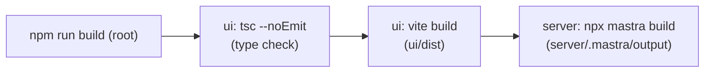

# 11. Build, test, deploy

## What you will learn
- How the app is built.
- What tests exist and how to run them.
- What the repo says (and does not say) about CI/CD and deployment.
- What to ask before you ship.

## Honest summary

The repo shows how to **build** and **test**. It does **not** show how the app is deployed. I found no Dockerfile, no Helm chart, no CI or CD workflow, no scan configuration and no release notes. Everything below about deployment is therefore a list of questions, not facts.

## The build

`npm run build` at the root runs `node run.mjs build`, which runs two commands in order (`run.mjs`, `build`):

| Step | Command | Output | Defined in |
|---|---|---|---|
| UI type check and build | `npm run build` in `ui/` (`tsc --noEmit && vite build`) | `ui/dist/` | `ui/package.json` |
| Server bundle | `npx mastra build` in `server/` | `server/.mastra/output/` | `run.mjs`, `server/package.json` |

The server build bundles the code and then installs dependencies into the output folder. Run it with `node .mastra/output/index.mjs`, which the build log itself suggests. The repo's own launcher uses `mastra start` instead (`run.mjs`, `start`).

If any step fails, `run.mjs` exits with that step's code, so later steps do not run.

Both output folders are git-ignored (`.gitignore`: `dist`, `.mastra`).

## Starting what you built

`npm start` runs `mastra start --env .env` in `server/` with `PORT` and `UI_DIST` set (`run.mjs`, `start`). It first checks that `server/.env`, `ui/dist/index.html` and `server/.mastra/output` exist.

A change to server code only takes effect after `npm run build`, because the server runs the built copy.

## Tests

| Where | Command | What it covers |
|---|---|---|
| `server/` | `npm test` (`vitest run`) | Login (PKCE, sessions, refresh), both Genie clients, chart spec building |
| `server/` | `npm run typecheck` | Types in `src/` only |
| `ui/` | `npm test` (`vitest run`) | How each chart type is turned into Plotly data (`ui/src/charts/plotlyFigures.test.ts`) |
| `ui/` | `npm run typecheck` | Types |

Test files: `server/src/auth/auth.test.ts`, `server/src/genie/client.test.ts`, `server/src/genie/agentClient.test.ts`, `server/src/mastra/chartSpec.test.ts`.

The tests pass fake `fetch` functions into the clients, so they do not call Databricks. That is why the clients take a `fetchFn` argument (`server/src/genie/client.ts`, constructor).

**Not covered by tests:** the routes in `server/src/mastra/index.ts`, the tools in `server/src/mastra/tools/askGenie.ts`, the agents and their instructions, and the UI apart from the Plotly figure logic.

## CI/CD, scans, environments, release

Nothing in the repo. The questions to ask before you ship:

1. Where is the pipeline defined, and what does it run (type check, tests, build)?
2. Are there security or dependency scans?
3. Which environments exist (the task brief mentions dev, QC and prod), and how does code reach each?
4. How is the app packaged: a container, a plain Node process, something else?
5. How are settings and secrets given to each environment?
6. Is there more than one server copy? Sessions and conversation ids are in memory, so more than one copy would break sign-in (see [08-auth-and-access.md](08-auth-and-access.md)).
7. How is the release done, and who approves it?

These are recorded in [99-open-questions.md](99-open-questions.md).

## Things to check on any server you deploy to

These come from reading the code (not from a deploy file):

- The server needs write access to its working folder for the SQLite files `mastra.db` and `bi-memory.db`.
- Browsers load fonts from Google Fonts (`ui/index.html`). A locked-down network may block that.
- The OAuth redirect address must match what is registered in Databricks (`server/src/auth/oauth.ts`).
- The cookie gets the `Secure` flag only when the request URL is `https` (`server/src/mastra/index.ts`). Check how a proxy in front forwards the protocol.

## Key takeaways
- Build is two steps: UI (type check and Vite), then server (`mastra build`).
- Tests cover the Genie clients, login and chart building. Routes, tools and the UI have none.
- No CI, container or deployment files are in the repo.
- Rebuild before `npm start` if you changed code.

## Where to look in the code
- `run.mjs`: build and start steps.
- `ui/package.json`, `server/package.json`: scripts.
- `.gitignore`: build output that is not committed.
- The four `*.test.ts` files listed above.
